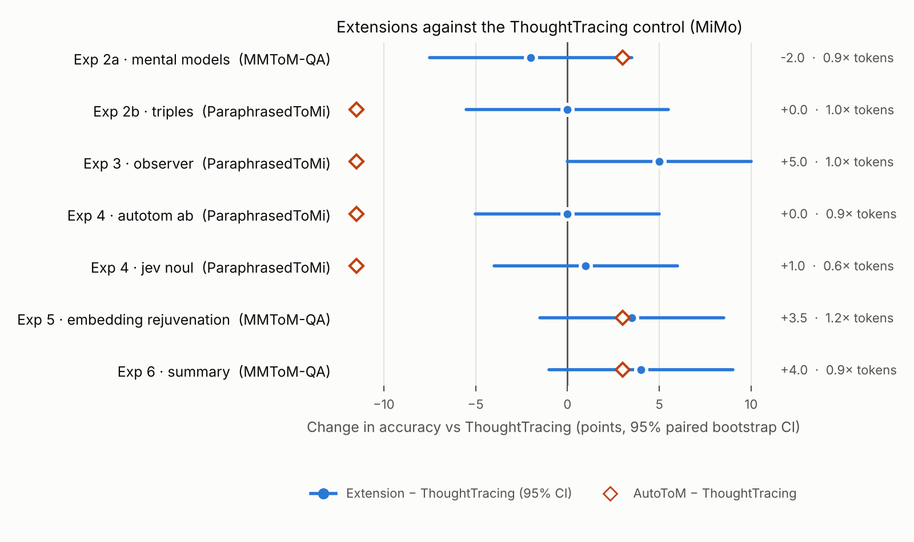

# ThoughtTracing × AutoToM

A CS6101 (Rational Approaches to Cooperative Intelligence, NUS) project by Zhang Ke Wei and Yakoob Ahmad Hanif.

## Background

*Theory of Mind* (ToM) is the ability to work out what someone else believes or wants from what they
see and do. The classic test: Sally puts an apple in a basket and leaves, Anne moves it to a box, and
we ask where Sally will look. Bayesian Theory of Mind answers this by asking which beliefs and goals
best explain the agent's actions. That is exact but hard to scale beyond toy worlds.

Two recent papers use large language models (LLMs) to make it scale, in opposite ways:

- **[ThoughtTracing](https://arxiv.org/abs/2502.11881)** keeps a handful of free-text guesses
  ("hypotheses") about what the agent is thinking. After each event it updates them, reweights them by
  how well they explain the agent's action, and replaces near-duplicates. It never sees the question,
  so it is cheap and general.
- **[AutoToM](https://arxiv.org/abs/2502.15676)** builds an explicit Bayesian model of the agent
  (observations, beliefs, goals) for each question and computes the answer from it. In its paper it
  beats ThoughtTracing by a wide margin, but it needs the answer options and many more model calls.

**Our question:** does AutoToM still lead on a current open-weight model, and how much of its lead can
small, targeted changes to ThoughtTracing recover, without giving up what makes ThoughtTracing light?

## What we did

We ran the official code of both methods, pinned to fixed commits, with small patches that send every
model call through one shared client (see [`patches/README.md`](patches/README.md)). All main runs use
**MiMo-V2.6-Pro** (thinking off, temperature 0, four hypotheses). GPT-6 Sol is a closed-model check
on BigToM only. Every arm answers the same fixed questions, so arms can be compared question by question.

**Benchmarks:** BigToM (249 questions), MMToM-QA text-only (200), ParaphrasedToMi (200, half
false-belief and half true-belief) and ExploreToM (200, the newest benchmark).

**Experiments.** Experiment 1 compares the methods. Experiments 2 to 6 each change exactly one step of
ThoughtTracing and compare it with Experiment 1's ThoughtTracing run on the same questions.

| # | Experiment | Benchmark | What changes |
| --- | --- | --- | --- |
| 1 | Baselines | all four | Nothing: plain prompting vs AutoToM vs ThoughtTracing |
| 2a | Mental models | MMToM-QA | Hypotheses fill slots (belief, goal, ...) chosen per story by Jev, a model that returns probabilities instead of text |
| 2b | Relation triples | ParaphrasedToMi | Hypotheses are small sets of (who, relation, what) triples, e.g. (Sally, Believes, apple in basket) |
| 3 | Observer persona | ParaphrasedToMi | The update prompt calls the model a "neutral observer" instead of an "expert assistant" |
| 4 | Probability scoring | ParaphrasedToMi | Hypotheses are weighted by AutoToM's "A) Likely / B) Unlikely" probability, or by Jev's Noul probability, instead of a verbal scale |
| 5 | Embedding rejuvenation | MMToM-QA | Near-duplicate hypotheses are found by embedding similarity (not word overlap) and replaced by new, different ones |
| 6 | Trajectory summary | MMToM-QA | The update and weighting steps read a running summary of what the agent has seen, not the raw story |

## Results

### Experiment 1: which method wins?

Accuracy (%) with MiMo, plus model calls per question. GPT-6 Sol on BigToM: plain 99.6, AutoToM 81.5,
ThoughtTracing 96.4.

| Benchmark | Plain | AutoToM | ThoughtTracing | Calls per question (AutoToM / ThoughtTracing) |
| --- | --- | --- | --- | --- |
| BigToM | **99.2** | 80.7 | 98.0 | 32 / 23 |
| MMToM-QA | 45.0 | **64.5** | 61.5 | 60 / 36 |
| ParaphrasedToMi | 58.0 | 62.5 | **74.0** | 176 / 32 |
| ExploreToM | 53.5 | **59.0** | 47.5 | 237 / 33 |

- **AutoToM's lead from its paper is largely gone.** It is only 3 points ahead of ThoughtTracing on
  MMToM-QA (p = 0.44), loses on ParaphrasedToMi (−11.5 points, p = 0.015) and wins only on ExploreToM
  (+11.5, p = 0.036), where it needs about 7 times as many calls and 3 times as many tokens. Most of
  those calls come from its nested inference on second-order questions.
- **The methods fail differently.** On ParaphrasedToMi, ThoughtTracing gets 81% of false-belief
  questions against AutoToM's 45%, but AutoToM is better on true-belief ones (80% vs 67%), and
  ExploreToM shows the same pattern. ThoughtTracing's perception step decides whether the agent saw a
  change by whether the passage names the agent, so it often assumes the agent missed something.
  AutoToM answers from the latest time step and looks further back only when uncertain, so it often
  stops too early on false beliefs, which formed earlier.
- **Structure only pays off on hard benchmarks.** On BigToM, plain prompting is already near perfect
  and AutoToM gets 47 questions wrong that plain prompting gets right. Both methods clearly beat plain
  prompting on MMToM-QA, and ThoughtTracing does on ParaphrasedToMi (p < 0.001). On ExploreToM,
  ThoughtTracing is no better than plain prompting.
- **Goal questions stay hard for every method.** The MMToM-QA gains come entirely from belief
  questions. On goal questions all three approaches get only about a third right, mostly by picking the
  object already inside the container the agent is heading to. It is not clear why.

### Experiments 2–6: can small changes improve ThoughtTracing?

Change in accuracy against the ThoughtTracing control on the same 200 questions, with a 95% paired
bootstrap interval and an exact McNemar p-value.

| Experiment | Control → variant | Change (95% CI) | p | Tokens vs control |
| --- | --- | --- | --- | --- |
| 2a Mental models | 61.5 → 59.5 | −2.0 (−7.5, +3.5) | 0.58 | 0.9× |
| 2b Relation triples | 74.0 → 74.0 | 0.0 (−5.5, +5.5) | 1.00 | 1.0× |
| 3 Observer persona | 74.0 → **79.0** | **+5.0** (0.0, +10.0) | 0.08 | 1.0× |
| 4 AutoToM-style scoring | 74.0 → 74.0 | 0.0 (−5.0, +5.0) | 1.00 | 0.9× |
| 4 Jev scoring | 74.0 → 75.0 | +1.0 (−4.0, +6.0) | 0.85 | 0.6× |
| 5 Embedding rejuvenation | 61.5 → 65.0 | +3.5 (−1.5, +8.5) | 0.23 | 1.2× |
| 6 Trajectory summary | 61.5 → 65.5 | +4.0 (−1.0, +9.0) | 0.18 | 0.9× |



- **No change is significant at the 5% level** with 200 questions. The observer persona comes closest:
  +5 points, mostly on true-belief questions (67% → 74%), at no extra cost.
- **The summary (+4) and embedding rejuvenation (+3.5)** both lift ThoughtTracing above AutoToM on
  MMToM-QA, but neither gain is certain.
- **Structured hypotheses (2a, 2b) did not help.** This matches the ThoughtTracing authors' own
  experience that fixed structures worked less well than free text. In 2a, Jev picked "belief and
  goal" for every story, so it in effect tested fixed belief-and-goal slots.
- **Weighting is not the bottleneck.** ThoughtTracing's own weights come out exactly equal in
  57–89% of update steps, so they rarely tell hypotheses apart. Both new scorers almost always separate
  them, yet accuracy does not move. Jev matches the control with about a third fewer tokens.

### Caveats

- **4 ExploreToM questions are counted as wrong for AutoToM.** It hit the 1,500-call or 60-minute
  limit on these second-order questions without answering.
- **Free-text answers are graded by ThoughtTracing's own rule.** An answer counts as correct if it
  contains the right location. 8–11 correct answers per ParaphrasedToMi arm also name the wrong one.
  A strict grader lowers each free-text arm by 8 to 11 answers and changes no conclusion.
- **Token counts are a lower bound.** The API sometimes omits usage. By our estimate, the final results took about $50 of API calls.
- **GPT-6 Sol ties.** It produced 42 exact ties under AutoToM on BigToM, broken by taking the first option.

The per-question records behind every number are in `results/` (see [Results files](#results-files)).

## How to replicate

**Requirements:** Python 3.12+, Git, [`uv`](https://docs.astral.sh/uv/) and API keys for DeepInfra
(MiMo and the embedding model), OpenAI (GPT-6 Sol) and Jev.

```sh
bash scripts/bootstrap.sh      # fetch the pinned upstream code, apply our patches, install, run offline tests
cp .env.example .env           # then fill in the API keys (.env is never committed)
```

For ExploreToM, download the data file as described in
[`shared/benchmarks/data/exploretom/README.md`](shared/benchmarks/data/exploretom/README.md).

**Rebuild the tables and figure from the saved results** (no API calls):

```sh
.venv/bin/python -m shared.analysis.aggregate     # writes results/aggregate/
```

**Rerun the experiments** (live API calls). Runs resume, so questions already answered are skipped.

```sh
.venv/bin/python -m shared.runner.pilot --limit 3              # a 3-question pilot of every arm, with cost estimate
.venv/bin/python -m shared.runner.pilot --limit 0 --workers 8  # the full run (about 190K model calls; several hours)
.venv/bin/python -m experiments.exp3_persona.run --workers 8    # or one experiment at a time
```

Add `--retry-errors` to rerun only questions that crashed or timed out. See
[`experiments/README.md`](experiments/README.md) for per-experiment options.

**Tests:**

```sh
.venv/bin/python -m pytest -q          # offline tests, no API calls
.venv/bin/python -m pytest -q --live   # also a few real API calls; each skips if its key is missing
```

## Repository layout

| Path | What it holds |
| --- | --- |
| `experiments/expN_*/` | One folder per experiment: `run.py`, plus `variant.py` with the one changed step |
| `shared/models/` | One logged client for every model, and the A/B probability rule |
| `shared/benchmarks/` | Benchmark loaders and the frozen question sets |
| `shared/methods/` | Plain prompting, ThoughtTracing and AutoToM, each run per question in its own process |
| `shared/tracing/` | Hooks for swapping one ThoughtTracing step |
| `shared/runner/` | Resumable runs, scoring and per-question records |
| `shared/analysis/` | Paired statistics, the main table and the extension figure |
| `patches/` | Our compatibility patches to the pinned upstream code (`external/`, not committed) |
| `scripts/` | Setup, patch export, benchmark freezing, and `api_probes/` (the checks that chose the A/B probability rule) |
| `tests/` | Offline tests, plus opt-in live tests |
| `results/` | Results per experiment, model, benchmark and arm; tables and figure in `results/aggregate/` |

### Results files

Each arm folder holds `predictions.jsonl` (one record per question: answer, correctness, model calls and
tokens), `summary.json` (accuracy and cost) and `manifest.json` (the arm's settings and question IDs).
`retried.jsonl` keeps the first attempt of any question that was rerun after a crash. `pilot-N/`
folders are earlier N-question pilots. Full traces and raw call logs stay local and are not committed.

## Credits

ThoughtTracing (MIT) and AutoToM (Apache-2.0) are by their original authors. Their code is fetched at
pinned commits, and only the small patches in `patches/` are ours. ExploreToM data is CC BY-NC 4.0.
